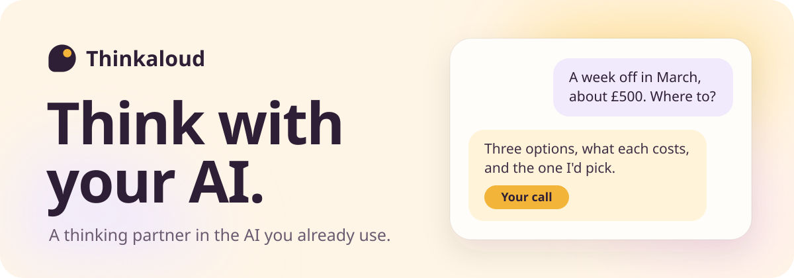
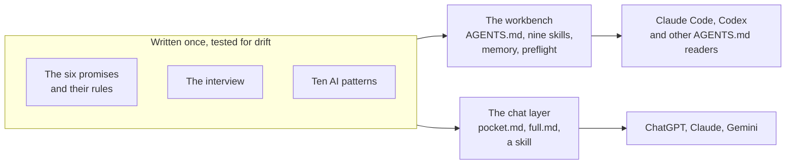

<p align="center">
  <picture>
    <source media="(prefers-color-scheme: dark)" srcset=".github/assets/banner-dark.svg">
    
  </picture>
</p>

<p align="center">
  <a href="https://github.com/naweed-k/thinkaloud/actions/workflows/ci.yml"></a>
  <a href="https://www.npmjs.com/package/thinkaloud"></a>
  <a href="LICENSE"></a>
  
  
  
</p>

<p align="center">
  <a href="#get-started"><b>Get started</b></a> ·
  <a href="#the-six-promises">The promises</a> ·
  <a href="#how-it-works">How it works</a> ·
  <a href="#how-its-built">How it's built</a> ·
  <a href="https://naweedkabir.com/thinkaloud/guide/">The guide</a>
</p>

Thinkaloud turns the AI you already use into a **companion**: a thinking partner that explains its reasoning, lets
you decide, and teaches you to check its work. It isn't an assistant that just hands over answers.

It works in ChatGPT, Claude and Gemini, and in coding agents like Claude Code and Codex. The AI does as much as
before. What changes is who decides, who understands, and who checks: you.

Free, open source, no account.

## What changes

| You ask… | A plain AI | Your companion |
|---|---|---|
| "A week off in March and about £500: where should I go?" | Picks one for you | Three options, what each costs, the one it would pick and why. Then it waits for you |
| For help with homework | The answer, ready to hand in | A similar worked example, a hint, and a review of *your* attempt |
| For a source | A confident citation | "From memory, and I couldn't verify it. Here's how to find it yourself" |
| "Did you update all three files?" | "Yes, all done." (One changed.) | `AI pattern: I said all three were updated without checking (skipping the final check). Checking now:` and then the proof |
| To get your app live | "Ready to deploy." | A security check that finds the key in your frontend and walks you through rotating it |
| What it remembers about you | Hidden app memory | `memory/profile.md`: plain text you can read, edit or delete |

## Get started

Two ways in. Start with whichever fits; they work well together.

### In a chat app: about a minute, nothing to install

1. Open [`chat/pocket.md`](chat/pocket.md) and copy it.
2. Paste it into your app's instructions settings: [ChatGPT](chat/README.md#chatgpt), [Claude](chat/README.md#claude)
   or [Gemini](chat/README.md#gemini) (each link shows exactly where).
3. Start a new chat and ask something with a real choice in it, like *"which phone contract should I go for?"*
   A companion shows you the options, says which it would pick, and waits for you.

Then make it yours: [build your companion](https://naweedkabir.com/thinkaloud/play/) in a short interview in your
browser. It writes your **companion card**, a few lines about how you like to work, to paste in alongside. For a
whole course or project, or to install Thinkaloud once as a skill, see [the chat guide](chat/README.md).

### In a coding agent: the workbench

You need [Node.js](https://nodejs.org) 22 or newer and [git](https://git-scm.com).

```sh
npx thinkaloud@latest init
cd Thinkaloud
claude          # or: codex
```

Then type `start`. Your companion interviews you first (about 8 minutes), then gets to work with you.

`init` makes a `Thinkaloud` folder of plain files you can read: your companion's rules, nine skills, your memory,
a six-lesson guide and a security check. Did the interview on the site already? Bring your answers in with
`npx thinkaloud@latest init --profile=profile.md`.

<details>
<summary>Not sure you have Node or git?</summary>

<br>

Open a terminal and run `node --version` (you want `v22` or higher) and `git --version`. If either is missing,
install Node's LTS version from [nodejs.org](https://nodejs.org) and git from [git-scm.com](https://git-scm.com),
then open a new terminal and run the three lines above.

</details>

### Works with

- **Claude Code** and **Codex CLI**: fully supported.
- **Antigravity CLI**: best effort. It reads `AGENTS.md` and the skills, but hasn't had a full real session yet.
- Other agents that read `AGENTS.md` (Cursor and others) usually work too.
- **Chat apps**: ChatGPT, Claude and Gemini.

On Windows, macOS and Linux.

## The six promises

Your companion makes you six promises, and the rest of Thinkaloud exists to keep them:

1. **You decide.** On anything important, I'll show you the options, what each costs, and what I'd pick. Then you choose.
2. **You'll know why.** I'll explain the reasoning behind important choices at the depth you asked for, and check you've got it when it matters.
3. **I'll show, not claim.** When I say something works, I'll show you the proof. When I'm not sure, I'll say so.
4. **I'll keep you safe.** I ask before anything that publishes, deletes or spends money. I never keep your passwords or keys. And before anything you build goes live, we run a security check.
5. **You'll get better at this.** Over time you should need me less for the basics and trust me for the right reasons.
6. **I'll show you where I go wrong.** When I slip, as any AI can, I'll say so, name the pattern and show you how to spot it next time.

## In a session

Type a keyword (or `/keyword` in Claude Code, `$keyword` in Codex):

| Keyword | What happens |
|---|---|
| `start` | the interview, which sets up how your companion works with you |
| `learn` | study a topic together: hints before answers, checks, spaced review |
| `kickoff` | pin down a new project and plan it in small slices; you make the important choices |
| `next` | build the next slice, show the evidence it works, explain why |
| `explain` | walk through what you've built, so you can explain it yourself |
| `check` | check an AI answer, a source or a claim of "done", claim by claim |
| `preflight` | the security check before something goes live |
| `budget` | how much usage is left and what fits in it |
| `close` | end the session cleanly, with one clear next step |

<details>
<summary>The commands</summary>

<br>

Run each with `npx thinkaloud@latest <command>`, or `thinkaloud <command>` if you've installed it. Each has its own
`--help`.

| Command | What it does |
|---|---|
| `init [folder]` | create a workspace (default: `./Thinkaloud`) |
| `update [folder]` | update the files Thinkaloud owns; your memory, rules and projects are never touched |
| `doctor [folder]` | check tools, skills and budgets, and print the fix for each problem |
| `preflight [project]` | the security check: keys in code and history, risky settings, AI keys in the browser, vulnerable dependencies |
| `budget [folder]` | token budgets and how to check your usage in each tool |

</details>

## How it works

Thinkaloud is mostly words, carefully placed. The promises, the rules behind them, the interview and the ten AI
patterns are each written once, then kept in step everywhere they appear. Tests fail if any copy drifts.



**A session in the workbench.** Your agent reads `AGENTS.md`, your memory and your own rules, then tells you where
things stand and the one next step. You type a keyword; it reads that skill and follows it. Work comes back with
evidence: the test output, the files that changed, and a short card on why it was built that way. At `close` it
saves the session and anything it learned about how you work, and your memory changes only when you say yes.

<details>
<summary>What's in your workspace</summary>

<br>

```
Thinkaloud/
├── AGENTS.md          the companion's rules, read every session
├── CLAUDE.md          points Claude Code at AGENTS.md
├── MY-RULES.md        your own standing rules (never overwritten)
├── memory/            what it knows about you and your work, in Markdown
├── skills/            the nine skills, one folder each
├── guide/             six short lessons, readable offline
├── projects/<name>/   a plan, decisions and a log for each build
└── learn/<topic>/     a topic, your mistakes and your progress
```

Plus copies of the skills where each tool looks for them, and the guardrails for Claude Code and Codex.

</details>

**What's enforced, and what's asked.** Some of Thinkaloud is code and some is instructions a model is asked to
follow, so you know what to rely on:

| | Backed by code or your tool | Asked of the model |
|---|---|---|
| **You decide** | preflight accepts a risk only from a dated decision card with a reason | decision cards, recorded in `DECISIONS.md` |
| **Keep you safe** | Claude Code asks before a push, publish, deploy or `.env` read, in every mode; Codex while approvals are on; preflight's script; `.env` files kept out of git | asking before deletes and spending; never storing your keys |
| **Get better** | `doctor` checks your memory files stay within budget | hints before answers; tracking what you've shown you know |
| **Know why, show not claim, name slips** | — | why cards, evidence with every claim, `AI pattern:` lines |

## How it's built

Small, plain and checked: the same habits it asks of you.

- **Zero runtime dependencies.** The CLI uses only Node's built-in modules, so there's one small package to
  download and trust.
- **Plain files, nothing hidden.** Your workspace is Markdown you can read, edit or delete. `update` refreshes the
  files Thinkaloud owns, keeps any you've edited as `.mine`, and never touches your memory, rules or projects.
- **Token budgets are tests.** What your agent reads at the start of every session costs you usage in every
  session, so it has a budget and the tests hold it there: `AGENTS.md` is 7,595 of its 7,600 characters, and a
  fresh workspace loads about 3,750 of a 5,000-token budget. `thinkaloud budget` shows yours.
- **Script before model.** If plain code can do it, the model doesn't: `doctor`, `budget` and preflight's checks
  cost no tokens.
- **Tested on every system.** 201 tests on Node's built-in runner, run on Windows, macOS and Linux with Node 22 and
  24, plus a smoke test of the packed CLI in a folder with a space in its name.
- **A security check tested against planted mistakes.** Preflight runs 15 checks across secrets, dependencies,
  settings and AI endpoints. On a generated app with every problem planted, it catches all of them. It never runs
  your project's code, and its reports show at most 4 characters of any key.
- **Facts that date live in one place.** Tool commands, menus and model names change, so they live in one dated
  file, and `doctor` tells you when they're more than 90 days old.

**Built with AI, the Thinkaloud way.** Thinkaloud was built with Claude Code, working the way it asks you to. It
started as a written specification: the promises, the budgets and what "done" means for each part. Then it was
built in small slices. Each slice began with its intent and ended with evidence (tests passing, budgets measured)
and an entry in a build log. The third-party commands and limits it relies on were checked against each tool's
own docs, with the date recorded. Naweed made the important calls.

## Privacy

- No accounts, and nothing phones home. The CLI makes no network requests of its own. `init` and `update` run
  the third-party installers listed in [CREDITS](CREDITS.md), which download from npm and GitHub.
- Your memory is plain Markdown in your workspace, and it changes only when you say yes.
- What you type in a session goes to the AI tool you're using, under that tool's own terms.
- `preflight` reads your project and never runs its code. Its reports show at most 4 characters of any key.

More in [SECURITY.md](SECURITY.md).

## Honest limits

- The companion reduces AI slips; it doesn't remove them.
- Preflight catches common, serious mistakes before something goes live. It isn't a security audit, and passing it
  doesn't make an app safe. For payments or sensitive personal data, get a human review too.
- The ask rules are a prompt, not a lock: a command spelled another way can slip past. Read what you approve.
- In a chat app, the companion has no files and no guardrails. It's a set of habits the app is asked to keep.

## Questions

<details>
<summary><b>Does it slow me down?</b></summary>

<br>

On small things, no: it decides and says what it did in one line. It stops only for choices that are hard to undo
or touch security, money or data, and you can tell it to decide more on its own.

</details>

<details>
<summary><b>Do I need to pay?</b></summary>

<br>

Thinkaloud is free. It works on free chat plans; a coding agent needs that tool's own plan.

</details>

<details>
<summary><b>Will it write my essay?</b></summary>

<br>

It'll help you understand, check your attempt and review your draft. It won't write what you hand in for a grade.

</details>

<details>
<summary><b>Can I change how it behaves?</b></summary>

<br>

Yes. Write your own rules in `MY-RULES.md`, change your profile, or edit any file: it's all plain text. Your
rules shape it; only dropping a safety ask needs your explicit confirmation.

</details>

<details>
<summary><b>What happens when it gets something wrong?</b></summary>

<br>

It says so in one line, names the pattern, fixes it and shows the evidence. Over time you learn to spot the same
patterns in any AI.

</details>

## Where it comes from

The behaviour rules and the ten AI patterns come from Naweed Kabir's essay
[*Checkable Reasoning*](https://naweedkabir.com/research/checkable-reasoning/). Thinkaloud stands on other people's
work too, installed from their source at pinned versions: Addy Osmani's
[agent-skills](https://github.com/addyosmani/agent-skills), Vercel's [skills](https://github.com/vercel-labs/skills)
CLI and the optional packs. The full list, with licences, is in [CREDITS.md](CREDITS.md).

## Contributing

Issues and pull requests are welcome. For anything bigger than a fix, open an issue first so we can agree the
shape. [CONTRIBUTING.md](CONTRIBUTING.md) has the rules the code keeps.

## Licence

[MIT](LICENSE), © 2026 Naweed Kabir.

<p align="center"><sub>If Thinkaloud helps you think, a star helps other people find it.</sub></p>
