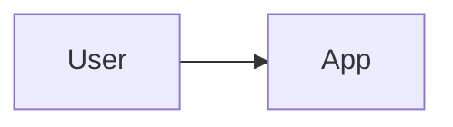

# <Project name>: plan

Approved: not yet
Audience: <personal | small | public> (sets how strict `preflight` is)

## Brief
- **What:** 
- **For whom:** 
- **What they do today without it:** 
- **What I want to learn from building it:** 

## Scope
**v1:**
- 

**Out of scope:**
- 

## Architecture
<a few lines, then a diagram>

Secrets live in: `.env` (git-ignored), documented in `.env.example`.

## Slices
Each slice leaves the app working. Size: S (small) · M (normal session) · L (fresh session, plenty of usage).

- [ ] **S1 · S · Walking skeleton:** runs locally with one test. *Verify by:* 
- [ ] **S2 · ? · <slice>:** *Verify by:* 
- [ ] **P · M · Preflight:** security check before going live (not needed for personal-only projects). *Verify by:* `preflight` shows no open fails
